# Core entity relationships

The diagram highlights tenant ownership and main relationships. The full table inventory and module mapping cover remaining relations.

```mermaid
erDiagram
  UNIVERSITIES ||--o{ UNIVERSITY_ADDRESSES : has
  UNIVERSITIES ||--o| UNIVERSITY_CONTACTS : has
  UNIVERSITIES ||--o| UNIVERSITY_ACCREDITATIONS : has
  UNIVERSITIES ||--o| UNIVERSITY_BRANDING : has
  UNIVERSITIES ||--o{ CAMPUSES : owns
  UNIVERSITIES ||--o{ AFFILIATED_COLLEGES : affiliates
  UNIVERSITIES ||--o{ INSTITUTIONAL_USERS : authorizes
  UNIVERSITIES ||--o{ FACULTIES : defines
  UNIVERSITIES ||--o{ DEPARTMENTS : defines
  UNIVERSITIES ||--o{ PROGRAMMES : defines
  UNIVERSITIES ||--o{ COURSES : defines
  UNIVERSITIES ||--o{ ACADEMIC_SESSIONS : schedules
  UNIVERSITIES ||--o{ STUDENTS : enrolls
  UNIVERSITIES ||--o{ EMPLOYEES : employs
  UNIVERSITIES ||--o{ ERP_RECORDS : stores
  UNIVERSITIES ||--o{ TENANT_AUDIT_LOGS : audits
  CAMPUSES ||--o{ DEPARTMENTS : contains
  CAMPUSES ||--o{ AFFILIATED_COLLEGES : hosts
  AFFILIATED_COLLEGES ||--o{ STUDENTS : enrolls
  FACULTIES ||--o{ DEPARTMENTS : groups
  DEPARTMENTS ||--o{ PROGRAMMES : offers
  PROGRAMMES ||--o{ COURSES : contains
  ACADEMIC_SESSIONS ||--o{ ACADEMIC_TERMS : divides
  STUDENTS ||--o{ STUDENT_GUARDIANS : has
  STUDENTS ||--o{ STUDENT_DOCUMENTS : owns
  EMPLOYEES ||--o{ EMPLOYEE_QUALIFICATIONS : holds
  EMPLOYEES ||--o{ EMPLOYEE_EXPERIENCES : records
  EMPLOYEES ||--o{ EMPLOYEE_LEAVES : requests
  INSTITUTIONAL_USERS ||--o{ INSTITUTIONAL_USER_ROLES : assigned
  INSTITUTIONAL_ROLES ||--o{ INSTITUTIONAL_USER_ROLES : grants
  INSTITUTIONAL_ROLES ||--o{ INSTITUTIONAL_ROLE_PERMISSIONS : has
  INSTITUTIONAL_PERMISSIONS ||--o{ INSTITUTIONAL_ROLE_PERMISSIONS : assigned
  ANNOUNCEMENTS ||--o{ ANNOUNCEMENT_AUDIENCES : targets
  APPROVAL_WORKFLOWS ||--o{ APPROVAL_STEPS : defines
  APPROVAL_WORKFLOWS ||--o{ APPROVAL_REQUESTS : governs
  APPROVAL_REQUESTS ||--o{ APPROVAL_STEPS : tracks
  LIBRARY_BOOKS ||--o{ LIBRARY_LOANS : loaned
  HOSTEL_ROOMS ||--o{ HOSTEL_ALLOCATIONS : assigned
  TRANSPORT_ROUTES ||--o{ TRANSPORT_ALLOCATIONS : assigned
  ASSIGNMENTS ||--o{ ASSIGNMENT_SUBMISSIONS : receives
  VENDORS ||--o{ PURCHASE_ORDERS : receives
  PURCHASE_ORDERS ||--o{ PURCHASE_ORDER_ITEMS : contains
```

University tenant keys are required on their owned records. The backend validates references and derives caller scope for currently implemented APIs; each normalized domain CRUD service must enforce the same rule before it is exposed.
